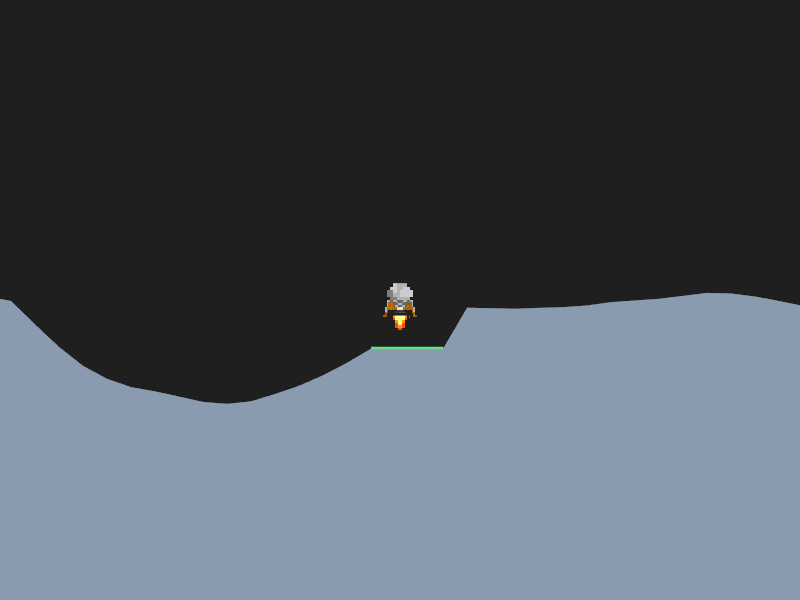

# Moonlander

This is an example implementation of a modern moon-lander game prototype in C++
using the [Magnum Graphics Engine](https://github.com/mosra/magnum).



## Linux Instructions

### Fedora
There are Corrade, Magnum, and JoltPhysics packages in the [TEK Federation RPM Repository](https://rpm.tekfed.org/fedora/44/x86_64/). 

## Windows Instructions
**Install Corrade and Magnum from sources**

Install [MSYS2](https://www.msys2.org/) and open a **UCRT64** (or **CLANG64**) shell and follow
[instructions](https://doc.magnum.graphics/magnum/building-integration.html#building-integration-packages-msys)
to build the latest Magnum and Corrade packages.

**Install Box2D from official repository**
```
pacman -S mingw-w64-ucrt-x86_64-box2d
# or ...
pacman -S mingw-w64-clang-x86_64-box2d
```
